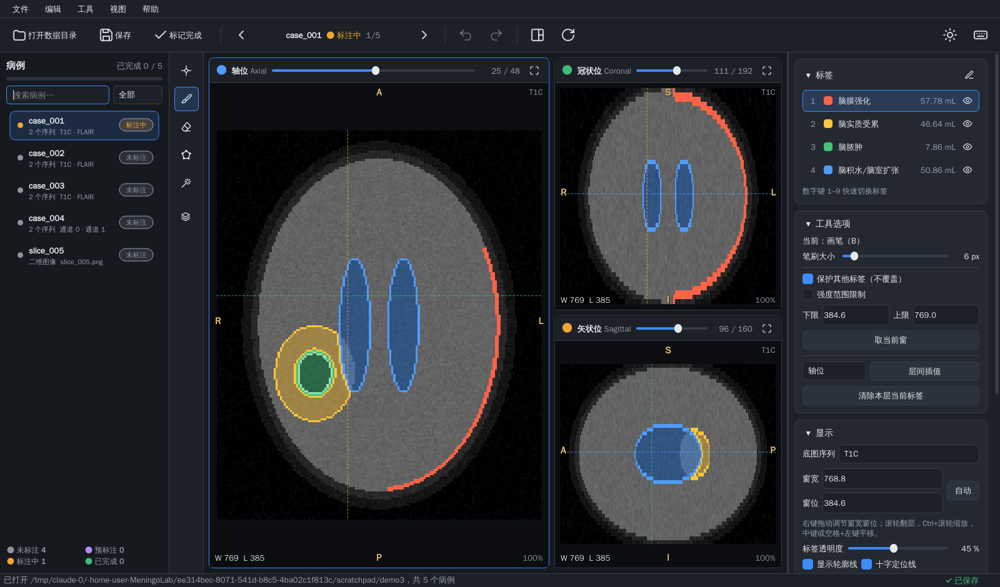

# MLab · 脑膜炎病灶标注工具

MLab 是一个面向医生的桌面标注软件，用于在 MRI 三维影像（NIfTI）和二维图片上勾画脑膜炎相关病灶，
并支持加载 **nnU-Net v2** 模型自动生成预标注，医生只需修改确认。



> 截图使用 `scripts/make_demo_data.py` 生成的合成数据，非真实病例。

## 功能（初版）

| 模块 | 内容 |
| --- | --- |
| 病例管理 | 打开数据根目录自动识别病例；状态跟踪（未标注 / 预标注 / 标注中 / 已完成）与进度条；搜索、按状态筛选；上一例 / 下一例；切换病例时自动保存（可关闭） |
| 影像 | NIfTI `.nii/.nii.gz`（任意方向，内部统一为 RAS），单序列或多序列（自动重采样到参考序列网格，可切换底图）；PNG/JPG/BMP/TIFF 二维图片（灰度或彩色） |
| 视图 | 轴位 / 冠状位 / 矢状位三视图联动十字线，可切换单视图；放射学方位标记（R/L/A/P/S/I）；窗宽窗位（右键拖动或数值输入）；缩放、平移；按体素间距正确显示比例 |
| 标注工具 | 画笔、橡皮擦（笔刷按物理尺寸保持圆形）；多边形 / 自由套索填充；区域生长（2D / 3D）；强度范围限制；保护其他标签不被覆盖；层间插值（符号距离场）；撤销 / 重做 |
| 标签 | 多类别，名称 / 颜色 / 标签值可编辑（保存在 `.mlab/labels.json`）；显示 / 隐藏；实时体积统计（mL）；数字键快速切换 |
| AI 预标注 | 加载 nnU-Net v2 训练结果目录；自动读取 `dataset.json` 的输入通道与标签；按文件名自动匹配序列到通道（失败时手动指定）；选择 GPU / CPU、折、权重、TTA；单例预标注（可撤销，可选择覆盖或仅填充空白）或批量预标注所有未标注病例；后台线程运行不卡界面 |
| 输出 | 与原图同空间、同方向、同仿射矩阵的 `uint8` 掩膜：三维为 `labels/<病例>.nii.gz`，二维为 `labels/<病例>.png`，可直接作为 nnU-Net 训练标签 |
| 界面 | 中文界面；深色 / 浅色主题一键切换；影像区始终为深色背景便于阅片 |

## 安装

需要 Python ≥ 3.9。

```bash
git clone <本仓库地址> MeningoLab
cd MeningoLab
python -m venv .venv && source .venv/bin/activate      # Windows: .venv\Scripts\activate
pip install -e .
```

如需 AI 预标注，再安装 nnU-Net：

```bash
# 有 NVIDIA 显卡：先按 https://pytorch.org 选择对应 CUDA 版本安装 torch，然后
pip install nnunetv2
# 仅 CPU：直接安装即可（推理较慢，可关闭 TTA 加速）
pip install torch nnunetv2
```

## 启动

```bash
mlab                      # 或 python -m mlab
mlab /path/to/数据目录     # 启动并直接打开数据目录
```

想先试用可以生成一套合成演示数据：

```bash
python scripts/make_demo_data.py demo_data
mlab demo_data
```

## 数据目录约定

```
数据根目录/
├── case_001/                 # 子文件夹 = 一个病例，内含一个或多个已配准序列
│   ├── T1C.nii.gz            # 文件名含 T1C/T1CE/Gd/增强 的序列默认作为底图
│   └── FLAIR.nii.gz
├── case_002_0000.nii.gz      # nnU-Net 命名：同一前缀 + _0000/_0001 通道后缀
├── case_002_0001.nii.gz
├── case_003.nii.gz           # 单个文件即一个病例
├── imagesTr/                 # nnU-Net 原始数据目录也可直接识别
├── slide_01.png              # 二维图片：每张图一个病例
├── labels/                   # ← MLab 保存的标注
└── .mlab/                    # ← 病例状态（project.json）与标签定义（labels.json）
```

文件名包含 `seg / label / mask / gt` 的影像会被视为掩膜而不是序列。若 `labels/` 下已有同名标注文件，打开病例时会自动载入。

## AI 预标注（nnU-Net v2）

1. 右侧「AI 预标注」卡片中点击 **＋**，选择 nnU-Net 训练结果目录，例如
   `nnUNet_results/Dataset101_Meningitis/nnUNetTrainer__nnUNetPlans__3d_fullres`
   （也可以选择其上级目录，MLab 会自动查找）。
2. 选择设备（自动 / GPU / CPU）、折（单折或多折集成）、权重文件、是否启用 TTA。
3. **预标注当前病例**：结果直接叠加到当前标注上，可 `Ctrl+Z` 撤销。
   「应用方式」可选“仅填充空白区域”（保留医生已画内容）或“覆盖当前全部标注”。
4. **批量预标注**：对所有“未标注”且尚无标注文件的病例推理并保存，状态变为“预标注”。

输入通道匹配规则：nnU-Net 后缀（`_0000`）→ 文件名包含 `dataset.json` 中的通道名（如 `T1C`、`FLAIR`）→ 数量一致时按顺序；
都无法确定时会弹窗让你手动指定。模型输出的标签值若在 MLab 中尚未定义，会以模型中的名称自动添加。

## 操作速查

| 操作 | 方式 |
| --- | --- |
| 翻层 | 滚轮 / ↑↓（PageUp/PageDown 跳 5 层）/ 视图标题栏滑块 |
| 缩放 / 平移 / 重置 | Ctrl+滚轮 / 中键拖动或空格+左键 / `R` |
| 窗宽窗位 | 右键拖动（左右调窗宽，上下调窗位）；「显示」卡片中「自动」恢复 |
| 工具 | `N` 浏览定位、`B` 画笔（Shift+拖动擦除）、`E` 橡皮擦、`P` 多边形/套索、`G` 区域生长 |
| 笔刷大小 | `[` / `]` |
| 切换标签 | 数字键 `1`–`9` |
| 多边形 | 单击加点；双击 / 右键 / 回车闭合；按住拖动为自由套索；Backspace 撤点；Esc 取消 |
| 层间插值 | `Ctrl+I`（在至少两个不相邻层画好当前标签后补全中间层） |
| 撤销 / 重做 | `Ctrl+Z` / `Ctrl+Y` |
| 保存 / 完成并下一例 | `Ctrl+S` / `Ctrl+Enter` |
| 上一例 / 下一例 | `Alt+←` / `Alt+→` |
| 单视图 / 三视图 | `F`，或双击视图（浏览工具下），或标题栏按钮 |
| 显示 / 隐藏标签 | `H` |

完整列表见菜单「帮助 → 快捷键」（F1）。

## 开发

```bash
pip install -e ".[dev]"
pytest                    # 界面测试以离屏模式运行
# 可选：用真实 nnU-Net 模型测试推理
MLAB_TEST_NNUNET_MODEL=/path/to/nnUNetTrainer__nnUNetPlans__3d_fullres pytest tests/test_nnunet_integration.py
```

代码结构：

```
mlab/
├── core/          与界面无关的逻辑：影像读写与方向（volume）、标签（labels）、撤销重做（segmentation）、
│                  标注算法（tools）、渲染（render）、项目与病例（project）
├── inference/     nnU-Net v2 封装（模型解析、通道匹配、推理）
└── ui/            PySide6 界面：主窗口、三视图、病例列表、侧边面板、主题与图标
```

## 后续可扩展方向

- DICOM 序列直接读取（目前需先转换为 NIfTI，例如使用 dcm2niix）
- 交互式分割模型（SAM / MedSAM 点选、框选）
- 标注审核流程（多医生、复核意见、版本记录）
- 病灶连通域列表与逐个跳转、导出统计报表
